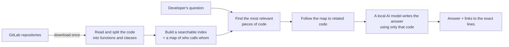
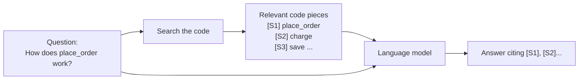
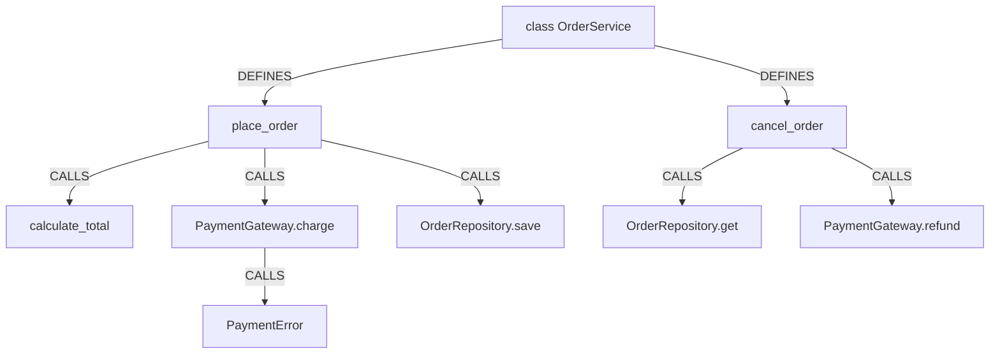
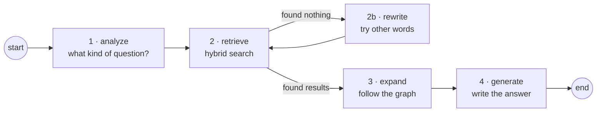
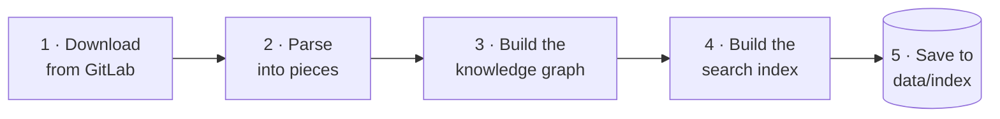
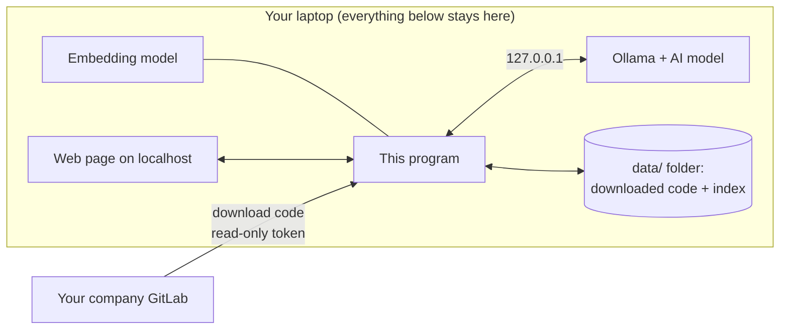

# How This Project Works: A Guide for People New to AI

This document explains the **GitLab GraphRAG Code Assistant** from scratch. You don't need any background in
AI or machine learning. If you can read a little code and know roughly what a Git repository is, you have
everything you need.

**Contents**

1. [The problem we're solving](#1-the-problem-were-solving)
2. [The 30-second summary](#2-the-30-second-summary)
3. [Background: the ideas behind it](#3-background-the-ideas-behind-it)
   - [3.1 What is a "language model"?](#31-what-is-a-language-model)
   - [3.2 Why not just give the model all the code?](#32-why-not-just-give-the-model-all-the-code)
   - [3.3 RAG: the open-book exam](#33-rag-the-open-book-exam)
   - [3.4 Keyword search (BM25)](#34-keyword-search-bm25)
   - [3.5 Meaning search (embeddings)](#35-meaning-search-embeddings)
   - [3.6 Combining both searches (hybrid search)](#36-combining-both-searches-hybrid-search)
   - [3.7 The knowledge graph: a map of the code](#37-the-knowledge-graph-a-map-of-the-code)
   - [3.8 GraphRAG = search + map](#38-graphrag--search--map)
   - [3.9 The "agent": a flowchart that runs itself](#39-the-agent-a-flowchart-that-runs-itself)
   - [3.10 Running the model on your own laptop (Ollama)](#310-running-the-model-on-your-own-laptop-ollama)
4. [Part A: building the index (done once)](#4-part-a-building-the-index-done-once)
5. [Part B: answering a question, step by step](#5-part-b-answering-a-question-step-by-step)
6. [Where your data goes (privacy)](#6-where-your-data-goes-privacy)
7. [A tour of the code](#7-a-tour-of-the-code)
8. [What it's good at, and where it struggles](#8-what-its-good-at-and-where-it-struggles)
9. [Frequently asked questions](#9-frequently-asked-questions)
10. [Glossary](#10-glossary)

---

## 1. The problem we're solving

Large companies have hundreds of code repositories. When a developer joins a team or touches an unfamiliar
service, they need answers like these:

- *"Where is the login logic?"*
- *"Which files deal with payments?"*
- *"How does placing an order actually work, step by step?"*
- *"Which of our repositories send email notifications?"*

Today, finding these answers means searching around, opening dozens of files, following function calls by hand,
and asking colleagues. That's slow.

**This project lets a developer ask such questions in plain English and get an answer that points to the exact
files and lines in GitLab,** with short code excerpts. It's like a colleague who has read all the code and
always shows you where they found the answer.

For the prototype, it works on a handful of sample repositories from the `MS-ClientServices` GitLab group,
not the whole company.

---

## 2. The 30-second summary



1. **Once:** download the repositories, break the code into small pieces (functions, classes), and build two
   things: a **search index** and a **map** of how the pieces connect.
2. **Per question:** search for the relevant pieces, use the map to pull in connected pieces, hand them to an AI
   model running **on your own laptop**, and have it write an answer that cites its sources.

Nothing is sent to any outside AI company.

---

## 3. Background: the ideas behind it

### 3.1 What is a "language model"?

A **language model** (often called an **LLM**, for *Large Language Model*) is a program that has read an enormous
amount of text and code. Its basic skill is predicting what text should come next. Think of the autocomplete on
your phone, made vastly more powerful. That one skill turns out to be enough to answer questions, explain code
and summarise documents.

Three things about LLMs matter for this project:

| Fact | What it means for us |
|---|---|
| **It has never seen your company's code.** It learned from public material. | We have to *show* it the relevant code every time we ask something. |
| **It can make things up.** When it doesn't know, it may produce a confident-sounding but wrong answer (called *hallucination*). | We tell it to answer *only* from the code we give it, and to cite where each fact came from, so a human can check. |
| **It can only read a limited amount at once.** This limit is called the **context window**. It is measured in *tokens*, which are word pieces; one token is roughly ¾ of a word. | We can't give it a whole repository. We have to pick the few most relevant pieces. |

### 3.2 Why not just give the model all the code?

A medium-sized repository has hundreds of thousands of lines. The model we use reads about 8,000 tokens per
question, which is a few hundred lines. Even if it could read more, a laptop processor would take many minutes
to get through it, and the answer gets *worse* when the relevant part is buried in irrelevant code.

So the real work is **finding the right few pieces of code**. Most of this project is about doing that well.

### 3.3 RAG: the open-book exam

The standard solution is called **RAG**, short for **Retrieval-Augmented Generation**:

- **Retrieval:** search for the pieces of code relevant to the question.
- **Augmented:** add them to the question.
- **Generation:** the model generates an answer from them.

It's an **open-book exam**. The model doesn't need to have memorised your code. We hand it the right pages and
it answers from them. Because we know which pages we handed it, we can show the developer exactly where the
answer came from.



### 3.4 Keyword search (BM25)

The first kind of search is the familiar one: matching **words**.

The code is split into words, a step called **tokenizing**. Code has its own naming conventions, so we split
names apart while also keeping the full name. This is the project's real output:

```
"PaymentGateway.charge refund_order"
   → paymentgateway, payment, gateway, charge, refund_order, refund, order
```

So a question mentioning "payment" finds `PaymentGateway` even though the exact word never appears on its own.

The scoring formula is called **BM25**. It's the classic formula behind many search engines. In plain terms it
rewards a piece of code when:
- it contains the question's words, and contains them several times;
- those words are **rare** across the codebase. The word "order" in an order service is everywhere and tells
  us little. The word "refund" is rarer and tells us a lot;
- the piece is focused rather than enormous.

**Strength:** precise, especially when you use real names such as `place_order` or `EmailSender`.
**Weakness:** it only matches words. Ask about "signing in" and it won't find a function called `login`.

### 3.5 Meaning search (embeddings)

The second kind of search matches **meaning**. It's the part that feels like "AI".

An **embedding model** is a small AI model that turns a piece of text into a list of numbers, called a
**vector**. We use `bge-small`, which produces 384 numbers per piece. The model is trained so that **texts with
similar meanings get similar numbers**.

Think of it as giving every piece of code a location on a huge map with 384 directions instead of 2. Code about
payments ends up in the "payments neighbourhood", and code about email lands somewhere else. To search, we
turn the *question* into a location too and look for the nearest pieces of code.

These are the project's real numbers for the question *"charge a customer's card"*. A score of 1.0 means
identical meaning:

| Piece of code | Similarity |
|---|---|
| `PaymentGateway.charge` | **0.713** |
| `EmailSender.send` | 0.535 |
| `OrderRepository.save` | 0.514 |

The payment function wins even though the question shares almost no words with its code.

**Strength:** understands synonyms and descriptions ("signing in" finds `login`).
**Weakness:** fuzzier. It can rank something "kind of related" above the exact function you named.

### 3.6 Combining both searches (hybrid search)

Each search has blind spots, so we run **both** and merge the results. This is called **hybrid search**.

The merging method is **Reciprocal Rank Fusion (RRF)**. Imagine two judges who each rank the candidates. Instead
of comparing their scores, which use different scales, we give points for **rank position**: 1st place gets the
most points, 2nd a bit fewer, and so on. A piece of code that both judges place near the top wins. On top of that,
if the question contains an exact function or class name, that piece gets a bonus.

### 3.7 The knowledge graph: a map of the code

Search finds the code that *looks* relevant. Understanding code often needs code that *doesn't* look relevant
at all.

Take this function from our sample repositories:

```python
def place_order(self, account_id, items):
    """Validate the cart, charge the customer and store the order."""
    total = calculate_total(items)
    txn = self.gateway.charge(account_id, total)
    ...
    self.repo.save(order)
```

To explain *how ordering works*, you need `calculate_total`, `charge` and `save`. Those functions don't mention
"orders" or "placing" at all, so a search for "how does place_order work" would rank them low or miss them.

That's why the project also builds a **knowledge graph**: a map of the code where:
- **nodes** (dots) are things: repositories, files, classes, functions;
- **edges** (arrows) are relationships between them.

| Arrow | Meaning | Example |
|---|---|---|
| CONTAINS | a repository contains a file | `order-service` → `orders/service.py` |
| DEFINES | a file or class defines something | `OrderService` → `place_order` |
| IMPORTS | a file uses another file or library | `service.py` → `payments.py`; `auth.ts` → `axios` |
| CALLS | a function calls another function | `place_order` → `charge` |
| INHERITS | a class extends another | `EmailSender` → `NotificationChannel` |

Here is part of the real graph built from the sample repositories:



Building this map takes no AI at all. The project reads the code like a compiler would: for each function, which
other functions does it call, and which files does it import? For Python it uses Python's own code reader, so it's
exact. For other languages it uses pattern matching, which is approximate.

### 3.8 GraphRAG = search + map

**GraphRAG** means combining the two:
1. **Search** finds the best starting points.
2. **The graph** is then followed outward from those starting points to collect the connected code.

It's like asking a librarian for a book, then also getting the books it cites and the books that cite it.

GraphRAG also works the other way. When search finds something that is *also* directly connected to the top
result, we trust it more and move it up the list. Two independent signals agree.

### 3.9 The "agent": a flowchart that runs itself

People call a program an **agent** when it takes several steps and decides what to do next based on what it finds.
Ours is a small flowchart, built with a library called **LangGraph**, which is designed for exactly this:



The key decision happens at step 1. Different questions need different amounts of map-following:

| Kind of question | Example | How far it follows the map |
|---|---|---|
| **locate** | "Where is login implemented?" | 1 step: the function and its immediate neighbours |
| **related** | "Which files relate to payments?" | 1 step, along all kinds of arrows, including imports |
| **explain** | "How does place_order work?" | **2 steps**, mainly along CALLS, so the whole chain of calls is included |
| **repos** | "Which repositories send email?" | Also adds up relevance per repository and ranks them |

### 3.10 Running the model on your own laptop (Ollama)

Most people use AI through websites or online services. Your question, and any code you paste, travels to the
provider's servers. For company code, that's often not allowed.

Instead, we download an **open-weight model**: a model whose files are published so you can run it yourself.
We run it with **Ollama**, a free program that runs such models on a normal computer. When our code asks Ollama a
question, it talks to `127.0.0.1`, which means *"this same computer"*. Nothing goes over the network.

Some terms you'll see:

| Term | Meaning |
|---|---|
| **Model name** `qwen2.5-coder:7b` | *Qwen 2.5 Coder* is a model family trained especially on code. *7b* means 7 **b**illion **parameters** |
| **Parameters** | The numbers inside the model that hold what it learned. More parameters usually means smarter, but more memory and slower |
| **Quantization** | Storing those numbers with less precision to save memory. It's why a 7-billion-parameter model fits in about 5 GB of RAM instead of 28 GB, with little quality loss |
| **CPU vs GPU** | AI runs much faster on a graphics card (GPU). Our target laptop has none, so it runs on the main processor (CPU). That works, but an answer takes 30–90 seconds |

The project also uses a second, much smaller local model, `bge-small` (about 130 MB), for the meaning search in section 3.5.

---

## 4. Part A: building the index (done once)

You run `graphrag-gitlab ingest`. These steps happen in order:



**1. Download.** The program connects to your company GitLab with a read-only access token and lists the
projects in the `MS-ClientServices` group. It picks the ones you named, or the most recently active few, and
downloads each as a zip file **at a specific commit**. A commit is a saved version, identified by a long code
called a *sha*. Pinning the commit means the links in answers keep pointing at the right lines, even after
someone changes the code later.

**2. Parse.** Each file is read and split into **chunks**, meaning pieces:
- every **function**, **method** and **class**, with its name, line numbers, description comment and code;
- a **summary chunk** per file (its first lines plus a list of what it defines);
- **documentation** such as README files, split into sections by heading;
- **config files** (YAML, Dockerfile, SQL…) as whole-file chunks.

It skips things that aren't useful: downloaded libraries (`node_modules`, `vendor`), build output, minified files,
binary files and very large files.

**3. Build the knowledge graph.** Every chunk becomes a dot on the map. The program then adds the arrows from
section 3.7 by looking at imports, function calls and class definitions. It takes care not to invent connections:
for example, calling `.get()` on a dictionary is *not* linked to some unrelated `get` function in the project.

**4. Build the search index.** Every chunk is tokenized for keyword search (section 3.4) and turned into 384
numbers by the embedding model for meaning search (section 3.5).

**5. Save.** Everything is written to the `data/index/` folder as plain files. There is no database to install.
For the three tiny sample repositories, this produces 37 chunks and 43 nodes connected by 56 arrows.

---

## 5. Part B: answering a question, step by step

Here's what really happens when you ask **"How does place_order work?"** against the sample repositories.
The numbers below are real output from the project.

### Step 1: analyze

The program reads the question and recognises two things:
- the phrase "How does … work" means an **explain** question;
- `place_order` looks like a code name (it has an underscore), so it's treated as a **symbol** to look up exactly.

```
analyze: intent=explain  symbols=['place_order']
```

This step uses simple rules, not AI, so it's instant. Optionally (`USE_LLM_PLANNER=true`), the AI model can do
this step instead and suggest extra search words, but on a laptop CPU that costs an extra 15–30 seconds.

### Step 2: retrieve (hybrid search)

Both searches run.

| Rank | Keyword search (BM25 score) | Meaning search (similarity) |
|---|---|---|
| 1 | `OrderService.place_order` (7.9) | `OrderService.place_order` (0.77) |
| 2 | `OrderService` (4.3) | `OrderService` (0.74) |
| 3 | `orders/service.py` (3.8) | `orders/service.py` (0.72) |
| 4 | `OrderService.cancel_order` (1.1) | `orders/repository.py` (0.72) |

Both agree that `place_order` is the top hit, and it also gets the exact-name bonus. The results are merged
(section 3.6) into 6 starting points.

### Step 3: expand (follow the map)

Because this is an **explain** question, the program follows CALLS arrows up to 2 steps out from the starting
points. The final set of 6 pieces handed to the model:

| # | Piece of code | Why it was included |
|---|---|---|
| S1 | `OrderService.place_order` | exact name match |
| S2 | `OrderRepository.save` | search hit, **moved up** because `place_order` calls it |
| S3 | `OrderService` | search hit (the class that holds `place_order`) |
| S4 | `PaymentGateway.charge` | **from the graph**: called by `place_order` |
| S5 | `calculate_total` | **from the graph**: called by `place_order` |
| S6 | `PaymentError` | **from the graph**: raised inside `charge` (2 steps away) |

S4, S5 and S6 are the pieces search alone would have missed, and they're exactly what you need to explain the
flow. That's the value of GraphRAG.

### Step 4: generate (write the answer)

The 6 pieces are numbered `[S1]`…`[S6]` and sent to the local model with instructions: *answer only from these
sources, cite the number after every fact, don't invent code, say so if the answer isn't there.* Each piece also
lists its connections ("→ CALLS PaymentGateway.charge"), so the model can describe the flow in the right order.

The answer appears word by word as the model writes it (this is called *streaming*). It reads something like:

> `OrderService.place_order` handles a new order in three steps [S1]. First it calculates the total price with
> `calculate_total`, which adds up price × quantity for each item [S5]. Then it charges the customer through
> `PaymentGateway.charge`, which rejects non-positive amounts with a `PaymentError` [S4][S6]. Finally it stores
> the order with `OrderRepository.save` [S2].

Below the answer, every cited source is listed with a link straight to those lines in GitLab:

```
[S1] order-service/orders/service.py:12-18 (OrderService.place_order)
     https://gitlab.your-company.internal/MS-ClientServices/order-service/-/blob/<commit>/orders/service.py#L12-18
```

**A safety check at the end:** small models sometimes cite a source number that doesn't exist, such as `[S9]` when
there are only 6 sources. The program removes such citations automatically, so every remaining citation points
at real code.

**If the AI model isn't available** (Ollama not running, or `--no-llm`), steps 1–3 still run. Instead of a written
explanation, you get the ranked list of relevant code pieces with their links, which is still useful.

---

## 6. Where your data goes (privacy)



| What | Leaves the laptop? |
|---|---|
| Your questions | **No.** They go only to Ollama on the same machine |
| Code sent to the AI model | **No.** Same as above |
| Answers | **No** |
| Downloaded repositories and index | **No.** Stored in `data/`, which is never committed to Git |
| Connection to company GitLab | Only during `ingest`, to *download* the code |
| One-time setup downloads | The program, model and libraries are downloaded once. Nothing is uploaded |

The program also **actively protects** against accidents:
- It refuses to start if it's configured to use an AI server that isn't on this computer or the company's private network.
- It refuses Ollama "cloud" models (names ending in `-cloud`). Those look local but actually run on someone else's servers.
- It switches off usage statistics and tracing in the libraries it uses, some of which can send data to their makers if enabled.
- The web page only accepts connections from the laptop itself.
- `graphrag-gitlab doctor` checks all of this and prints `[OK]` or `[FAIL]` for each item.

The setup guide (`IMPLEMENTATION_GUIDE.md`, Phase 16) explains how to *prove* it: block all internet access for
the program with the firewall, and show that it still answers questions.

---

## 7. A tour of the code

Every file, and what it does in plain language:

| File | What it does |
|---|---|
| `graphrag_gitlab/privacy.py` | The safety guard: switches off telemetry and refuses non-local AI servers and cloud models |
| `graphrag_gitlab/config.py` | Reads the settings from the `.env` file (GitLab address, model name, how many sources, …) |
| `graphrag_gitlab/models.py` | Defines the basic "shapes" of data: a repository, a file, and a code piece (`Symbol`) |
| `graphrag_gitlab/ingest/gitlab_source.py` | Downloads the chosen repositories from GitLab |
| `graphrag_gitlab/ingest/local_source.py` | Uses repositories already on disk instead (for testing) |
| `graphrag_gitlab/parsing/__init__.py` | Walks through a repository's files and decides how to read each one |
| `graphrag_gitlab/parsing/python_parser.py` | Reads Python code exactly, using Python's own code reader |
| `graphrag_gitlab/parsing/generic_parser.py` | Reads Java, JavaScript/TypeScript, Go, C# and other languages with pattern matching |
| `graphrag_gitlab/graph/builder.py` | Builds the knowledge graph: the dots and arrows from section 3.7 |
| `graphrag_gitlab/index/text.py` | Splits code into words for keyword search |
| `graphrag_gitlab/index/embeddings.py` | Turns text into lists of numbers for meaning search |
| `graphrag_gitlab/index/store.py` | Runs both searches, merges them, follows the graph, and saves and loads everything |
| `graphrag_gitlab/agent/llm.py` | Talks to the local AI model through Ollama |
| `graphrag_gitlab/agent/prompts.py` | The written instructions given to the AI model |
| `graphrag_gitlab/agent/graph.py` | The agent flowchart from section 3.9 (analyze → retrieve → expand → generate) |
| `graphrag_gitlab/pipeline.py` | Runs Part A (download → parse → graph → index → save) |
| `graphrag_gitlab/cli.py` | The `graphrag-gitlab` command and its sub-commands |
| `app.py` | The web page (built with Streamlit) |
| `tests/` | Automatic checks, plus three tiny made-up repositories to test with |

**The libraries it relies on**, all free and open source:

| Library | Job |
|---|---|
| LangGraph | Runs the agent flowchart |
| NetworkX | Stores the knowledge graph |
| rank-bm25 | Keyword search scoring |
| sentence-transformers | Runs the embedding model for meaning search |
| NumPy | Fast maths on the lists of numbers |
| python-gitlab | Talks to GitLab |
| ollama | Talks to the local AI model |
| Streamlit | The web page |

---

## 8. What it's good at, and where it struggles

**Good at**
- Finding where something is implemented, including when you describe it in your own words.
- Explaining a flow across several functions and files, thanks to the graph.
- Pointing to evidence: every claim comes with a link you can click and check.
- Working with no internet and no paid services.

**Struggles with**
- **Speed on a laptop CPU.** Written answers take roughly 30–90 seconds. Retrieval-only answers are instant.
- **Very broad questions** like "explain the whole system". The model only sees about 6 pieces of code at a time.
- **Connections the code doesn't state directly.** For example, a service calling another over HTTP using a URL in
  a config file, or code wired together at runtime. The graph only knows about direct calls, imports and inheritance.
- **Languages other than Python** are read approximately, so some calls may be missed or, more rarely, wrongly linked.
- **Small local models are less capable** than large commercial ones. Always check the cited sources for anything important.
- **Freshness.** It knows the code as of the last `ingest`. Re-run it to pick up new commits.

---

## 9. Frequently asked questions

**Does it learn from my code, or change the AI model?**
No. The model is never retrained or modified. Your code is only *shown* to it, temporarily, while it answers one
question, and that happens entirely on your laptop.

**Is the answer always correct?**
No, which is why every answer cites its sources. Treat it like a knowledgeable colleague: usually right, worth
verifying when it matters. If it can't find the answer in the code, it's instructed to say so instead of guessing.

**Why do I need two models?**
They do different jobs. The small embedding model (`bge-small`) turns text into numbers for meaning search. It's
fast and runs during indexing and searching. The big language model (`qwen2.5-coder`) reads the found code and
writes the answer.

**What's the difference between this and normal code search (like GitLab's search box)?**
Normal search matches words and returns a list of files. This also understands meaning, follows how code
connects, and writes an explanation with references.

**Can it work without the AI model?**
Yes. Run with `--no-llm`, or just leave Ollama stopped. You still get the ranked, graph-expanded list of relevant
code with links, instantly.

**Can I make it faster or smarter?**
Faster: a smaller model (`qwen3:4b`) or fewer sources per question. Smarter: a bigger model, which needs more
RAM or a shared internal server with a graphics card. See section 21 of `IMPLEMENTATION_GUIDE.md`.

**How do I add more repositories?**
List them in `GITLAB_PROJECTS` in the `.env` file and run `graphrag-gitlab ingest` again.

---

## 10. Glossary

| Term | Plain-language meaning |
|---|---|
| **Agent** | A program that runs a series of steps and decides the next step based on what it found |
| **BM25** | A classic formula for scoring how well a text matches search words, favouring rare words |
| **Chunk** | One small piece of code or documentation that can be searched and shown on its own (e.g. one function) |
| **Citation** `[S1]` | A reference from the answer to the numbered source it came from |
| **Context window** | The maximum amount of text an AI model can read at once |
| **CPU / GPU** | The computer's main processor / graphics card. AI is much faster on a GPU |
| **Edge** | An arrow in the knowledge graph: a relationship such as "calls" or "imports" |
| **Embedding** | A list of numbers representing the *meaning* of a text. Similar meanings give similar numbers |
| **GraphRAG** | RAG that also uses a knowledge graph to find related information |
| **Hallucination** | When an AI model states something false with confidence |
| **Hybrid search** | Using keyword search and meaning search together |
| **Ingest** | The one-time process of downloading and indexing the repositories |
| **Knowledge graph** | A map of things (nodes) and how they relate (edges) |
| **LangGraph** | A library for building step-by-step AI workflows as flowcharts |
| **LLM** | Large Language Model: an AI that reads and writes text and code |
| **Local / on-device** | Running on your own computer, not on someone else's servers |
| **Node** | A dot in the knowledge graph: a repository, file, class or function |
| **Ollama** | Free software that runs open AI models on your own computer |
| **Open-weight model** | An AI model whose files are published so anyone can run it themselves |
| **Parameters** | The learned numbers inside an AI model. "7B" means 7 billion of them |
| **Parsing** | Reading code to understand its structure: which functions exist and what they call |
| **Prompt** | The full text given to an AI model: instructions + sources + question |
| **Quantization** | Compressing a model's numbers so it needs less memory |
| **RAG** | Retrieval-Augmented Generation: find relevant material first, then let the AI answer from it |
| **RRF** | Reciprocal Rank Fusion: merging two ranked lists by rewarding items ranked high in both |
| **Streaming** | Showing the answer word by word as it's generated |
| **Token** | A word piece; AI models count text in tokens (about ¾ of a word each) |
| **Tokenizing** | Splitting text into words or word pieces for searching |
| **Vector** | A list of numbers; here, the output of the embedding model |
